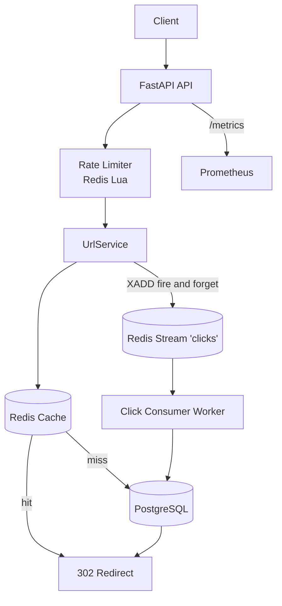

# URL Shortener

A production-quality URL shortener service built with **Python 3.12 + FastAPI**, demonstrating caching, atomic ID generation, rate limiting, async click analytics, clean layered architecture, testing, and observability.

It runs with a single `docker compose up`.

## Features

- Create short URLs with optional custom alias and expiry
- 302 redirect served from Redis cache whenever possible
- Atomic token-bucket rate limiting via a Redis Lua script (fails open)
- Base62 ID generation from a Redis counter with a Postgres sequence fallback
- Async click analytics through a Redis Stream + batch-insert worker
- Cache-aside with negative caching and per-key stampede locks
- Idempotency-Key support on creation
- Prometheus metrics and structlog JSON logs
- Liveness (`/health`) and readiness (`/ready`) probes

## Architecture



**Layers:** `routers → services → repositories`. Routers hold no business logic, services hold no SQL, and dependencies are injected through FastAPI `Depends`.

## Quick Start

```bash
cp .env.example .env
docker compose up --build
```

Services come up on:

| Service    | URL                      |
| ---------- | ------------------------ |
| API        | http://localhost:8000    |
| Prometheus | http://localhost:9090    |
| Postgres   | localhost:5432           |
| Redis      | localhost:6379           |

## Local Development

```bash
python -m venv .venv
source .venv/bin/activate        # Windows: .venv\Scripts\activate
make install
make migrate
make run                         # API on :8000
make worker                      # click consumer
```

## Testing

```bash
make test        # pytest with coverage
make lint        # ruff check
make typecheck   # mypy --strict on app/
```

Tests run against SQLite (via aiosqlite) and fakeredis, so no external services are needed.

## Load Testing

```bash
make loadtest
```

## API Examples

Create a short URL:

```bash
curl -X POST http://localhost:8000/api/v1/urls \
  -H "Content-Type: application/json" \
  -H "Idempotency-Key: my-unique-key" \
  -d '{"long_url": "https://example.com/very/long/path"}'
```

Create with a custom alias and expiry:

```bash
curl -X POST http://localhost:8000/api/v1/urls \
  -H "Content-Type: application/json" \
  -d '{"long_url": "https://example.com", "custom_alias": "mylink", "expires_at": "2030-01-01T00:00:00Z"}'
```

Redirect:

```bash
curl -i http://localhost:8000/mylink
```

Metadata:

```bash
curl http://localhost:8000/api/v1/urls/mylink
```

Delete (soft):

```bash
curl -X DELETE http://localhost:8000/api/v1/urls/mylink
```

Stats:

```bash
curl http://localhost:8000/api/v1/urls/mylink/stats
```

Health, readiness, metrics:

```bash
curl http://localhost:8000/health
curl http://localhost:8000/ready
curl http://localhost:8000/metrics
```

### Error Format

All errors return a consistent shape:

```json
{ "error": { "code": "conflict", "message": "custom alias is already in use" } }
```

## Configuration

All settings come from environment variables (see `.env.example`).

| Variable | Default | Description |
| -------- | ------- | ----------- |
| `DATABASE_URL` | `postgresql+asyncpg://...` | Async SQLAlchemy URL |
| `REDIS_URL` | `redis://localhost:6379/0` | Redis connection URL |
| `ID_COUNTER_OFFSET` | `1000000000` | Counter start so codes are ≥6 chars |
| `CACHE_TTL_SECONDS` | `86400` | Max cache TTL (capped to expiry) |
| `NEGATIVE_CACHE_TTL_SECONDS` | `60` | TTL for "not found" cache entries |
| `IDEMPOTENCY_TTL_SECONDS` | `86400` | Reserved for idempotency storage |
| `RATE_LIMIT_CREATE_PER_MIN` | `10` | Create limit per IP |
| `RATE_LIMIT_REDIRECT_PER_MIN` | `300` | Redirect limit per IP |
| `IP_HASH_SALT` | `change-me...` | Salt for SHA-256 IP hashing |
| `BASE_URL` | `http://localhost:8000` | Public base for short URLs |
| `CORS_ORIGINS` | `["http://localhost:3000"]` | Allowed CORS origins |
| `WORKER_BATCH_SIZE` | `500` | Max events per worker batch |
| `WORKER_POLL_INTERVAL_SECONDS` | `2.0` | Worker block/poll interval |
| `WORKER_CONSUMER_NAME` | `click-worker` | Consumer group member name |
| `CLICK_STREAM_KEY` | `clicks` | Redis Stream name |
| `CLICK_STREAM_GROUP` | `clicks-group` | Consumer group name |

## ID Generation

Codes come from a Redis `INCR` counter encoded in **base62**. The counter starts at `ID_COUNTER_OFFSET` (default 1,000,000,000) so every generated code is at least 6 characters, keeping the space dense and URLs short. If Redis is unreachable, the service falls back to a Postgres sequence and adds the same offset, so the fallback produces codes of comparable length. See [docs/DESIGN.md](docs/DESIGN.md) for the full trade-off analysis.

## Observability

- **Metrics:** `http_requests_total`, `http_request_duration_seconds`, `url_redirects_total{cache}`, `urls_created_total`, `rate_limited_total{endpoint}`, `cache_lookups_total{result}`, `stream_publish_failures_total`, plus worker batch and lag gauges.
- **Logs:** structlog JSON to stdout, one line per event.

## Sample Load-Test Results

Fill in after running `make loadtest` against a local `docker compose up` stack.

| Scenario | Users | Duration | p50 (ms) | p99 (ms) | RPS | Errors |
| -------- | ----- | -------- | -------- | -------- | --- | ------ |
| Redirect (cache hit) | 200 | 60s | TBD | TBD | TBD | TBD |
| Create | 50 | 60s | TBD | TBD | TBD | TBD |
| Mixed (100:1 read:write) | 200 | 60s | TBD | TBD | TBD | TBD |

Target: redirect **p99 < 20 ms** on cache hit.

## Project Layout

```
app/
  api/         routers, dependency wiring
  core/        config, logging, metrics, errors
  infra/       db, redis, cache, rate limiter, lua script
  models/      SQLAlchemy models
  repositories/  all SQL lives here
  schemas/     Pydantic models
  services/    business logic
worker/        click stream consumer
migrations/    Alembic versions
tests/         unit + integration
loadtest/      Locust scenario
docs/          DESIGN.md
```

See [docs/DESIGN.md](docs/DESIGN.md) for capacity math, scaling plan, failure modes, and interview Q&A.
