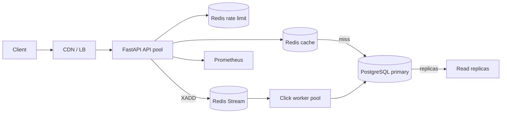

# System Design: URL Shortener

## 1. Requirements

### Functional

- Create a short URL from a long URL, with an optional custom alias and expiry
- Redirect a short code to its long URL, counting every click
- Return metadata for a short code
- Soft-delete a short code
- Report total clicks, clicks per day for the last 7 days, and top 5 referrers
- Health (`/health`), readiness (`/ready`), and Prometheus metrics (`/metrics`)
- Idempotent creation via an `Idempotency-Key` header

### Non-Functional

- Redirect p99 under **20 ms** on a cache hit
- Read:write ratio ≈ **100:1**, so reads dominate the design
- Redirects keep working if the analytics pipeline fails (graceful degradation)
- Target scale: **100M new URLs/month**, **10B redirects/month**

## 2. Capacity Estimates

**Traffic**

- 10B redirects / month ÷ 30 days ÷ 86,400 s ≈ **3.9K redirects/sec** average
- Peak (5× average) ≈ **19.5K redirects/sec**
- 100M creates / month ÷ 30 ÷ 86,400 ≈ **39 creates/sec** average, ~200/sec peak

**Storage (5 years)**

- 100M URLs/month × 12 × 5 = **6B URL rows**
- Row ≈ 200 bytes (code + long URL + timestamps) → 6B × 200 B ≈ **1.2 TB**
- Clicks: 10B/month × 60 = 600B raw events. Storing every raw row is ~**50 TB**, so we persist raw events only for a short retention window and rely on `click_daily` rollups (6B URLs × 365 days is not the right frame — rollups are per active code, roughly **1–2 TB**).

**Cache**

- Working set = hot codes. Assume 20% of codes serve 80% of traffic.
- 6B codes × 200 B payload = 1.2 TB total; caching the top 1% (60M codes) ≈ **12 GB**, comfortably on one Redis instance; scale out with a cache cluster keyed by `url:{code}`.

**Bandwidth**

- 19.5K redirects/sec × ~1 KB response ≈ **20 MB/s** egress at peak — modest; a CDN absorbs the long tail.

## 3. High-Level Architecture



**Write path:** validate → rate limit → allocate ID (Redis INCR) → insert row → prime cache → 201.

**Read path:** rate limit → check cache → on hit, 302 immediately → on miss, load from Postgres, prime cache → `XADD` click (fire and forget) → 302.

## 4. Data Model

```sql
urls(id BIGINT PK, short_code VARCHAR UNIQUE, long_url TEXT, created_at,
     expires_at NULL, is_deleted BOOL, idempotency_key NULL UNIQUE)
click_events(id BIGSERIAL, short_code INDEX, clicked_at INDEX,
             referrer NULL, user_agent NULL, ip_hash)
click_daily(short_code, day, count)          -- rollup for stats
click_referrer_daily(short_code, day, referrer, count)
url_sequences(id, value)                     -- Postgres fallback counter
```

**Why Postgres:** we need unique constraints on `short_code` and `idempotency_key`, transactional writes, and strong consistency for the ID fallback. Redis alone cannot provide durable, queryable storage. IPs are hashed with a salted SHA-256 and never stored raw.

## 5. ID Generation Alternatives

| Approach | Pros | Cons |
| -------- | ---- | ---- |
| Hash + collision retry | No counter | Retries on collision, uneven distribution |
| **Redis counter + base62** | Atomic, O(1), dense, sortable | Redis is a SPOF (mitigated by fallback) |
| Snowflake | Time-ordered, decentralized | 64-bit ids are long before base62 |
| UUID | No coordination | 128-bit → 22-char codes, not user-friendly |

We use a Redis `INCR` counter encoded in base62, starting at an offset of 1,000,000,000 so codes are ≥6 characters. If Redis is down, we fall back to a Postgres sequence plus the same offset, keeping code length consistent.

## 6. Caching

- **Pattern:** cache-aside. Key `url:{code}` → `{long_url, expires_at, is_deleted}`.
- **TTL:** 24h, capped to the URL's remaining expiry when set.
- **Negative caching:** "not found" cached for 60s to blunt enumeration attacks.
- **Stampede protection:** a short per-key Redis `SET NX` lock (5s) coalesces concurrent misses; other requests wait briefly or serve stale.
- **Hot-key problem:** a single viral code can dominate one shard. Mitigations: local in-process LRU in front of Redis, and CDN caching of redirect responses for the hottest codes.

## 7. Scaling Plan

1. **Read replicas:** route metadata/stats reads to replicas; redirects stay on cache and only hit the primary on miss.
2. **Sharding:** partition `urls` by hash of `short_code` once a single primary saturates.
3. **Redis cluster:** shard the cache and rate-limit keyspace; streams can be partitioned per key range.
4. **Multi-region:** deploy API + cache per region; replicate the URL table cross-region. ID generation per region via a block-allocation scheme (each region leases ranges) avoids cross-region counter contention.
5. **CDN:** cache 302s at the edge for very hot codes, with a short TTL so deletes/expiry still propagate quickly.

## 8. Failure Modes

| Failure | Behavior | Recovery |
| ------- | -------- | -------- |
| Redis down | Rate limiting fails open; redirects fall through to Postgres; ID gen uses Postgres sequence; clicks log a warning and redirects still succeed | Redis restarts, cache warms naturally |
| Postgres down | Creates and cache-miss redirects fail with 5xx; cached redirects keep serving | Failover to replica/primary |
| Worker down | Redirects unaffected; events buffer in the Redis Stream; stats go stale | Worker resumes, reclaims pending entries |
| Stream publish fails | Fire-and-forget; the redirect is unaffected; a counter tracks failures | Metric alerts on failure rate |
| Worker crash mid-batch | Un-ACKed entries stay pending; reclaim on restart (min-idle) dedupes via idempotent upserts | Automatic |

## 9. Trade-offs

- **302 vs 301:** we use **302** so every click is counted. 301 is cached by browsers and would undercount.
- **Soft delete:** preserves click history and lets stats continue to work; a hard delete would orphan `click_events`.
- **Eventual consistency of stats:** clicks are aggregated asynchronously, so stats can lag by up to the worker's poll interval (~2s). This decouples the hot redirect path from analytics writes.
- **Fire-and-forget clicks:** we favor redirect availability over perfect click counts.

## 10. Interview Q&A

1. **Why 302 and not 301?** To count every click; browsers cache 301s and would skip the server.
2. **Why a counter instead of a hash?** Counter is atomic and dense with no collision retries.
3. **What if Redis dies?** Rate limiting fails open, ID gen falls back to a Postgres sequence, redirects hit Postgres directly.
4. **How do you prevent enumeration?** Negative cache entries for unknown codes with a 60s TTL.
5. **How is the cache stampede prevented?** A short per-key `SET NX` lock coalesces concurrent misses.
6. **How are IPs kept private?** Salted SHA-256 hashes; raw IPs are never stored.
7. **Why a Redis Stream for clicks?** Decouples the hot path from analytics; the worker batches inserts.
8. **How is worker crash safety handled?** Consumer groups with pending-entry reclaim and idempotent rollup upserts.
9. **How would you scale to multi-region?** Block-allocate ID ranges per region and replicate the URL table.
10. **Why Postgres for storage?** Unique constraints, transactions, and queryable, durable storage Redis can't provide.
